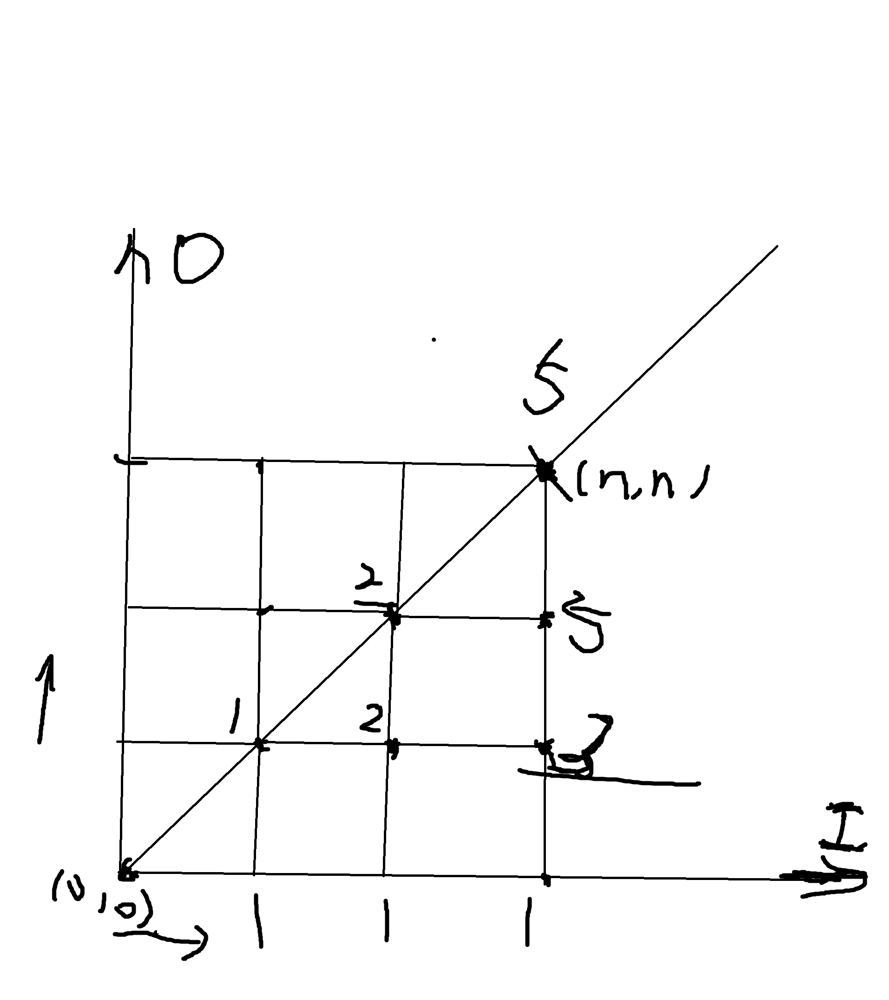

# 例题 
## 洛谷 P1044 [NOIP 2003 普及组] 栈
栈是计算机中经典的数据结构，简单的说，栈就是限制在一端进行插入删除操作的线性表。

栈有两种最重要的操作，即 pop（从栈顶弹出一个元素）和 push（将一个元素进栈）。

栈的重要性不言自明，任何一门数据结构的课程都会介绍栈。宁宁同学在复习栈的基本概念时，想到了一个书上没有讲过的问题，而他自己无法给出答案，所以需要你的帮忙。

题目描述

宁宁考虑的是这样一个问题：一个操作数序列，1,2,…,n（图示为 1 到 3 的情况），栈 A 的深度大于 n。

现在可以进行两种操作，

将一个数，从操作数序列的头端移到栈的头端（对应数据结构栈的 push 操作）
将一个数，从栈的头端移到输出序列的尾端（对应数据结构栈的 pop 操作）
使用这两种操作，由一个操作数序列就可以得到一系列的输出序列，下图所示为由 1 2 3 生成序列 2 3 1 的过程。

（原始状态如上图所示）

你的程序将对给定的 n，计算并输出由操作数序列 1,2,…,n 经过操作可能得到的输出序列的总数。

输入格式
输入文件只含一个整数 n（1≤n≤18）。

输出格式
输出文件只有一行，即可能输出序列的总数目。

输入输出样例
输入 #1复制

3
输出 #1复制

5  
## 解
考虑状态递归 : 先将数字1入栈，接下来将数字分为两波，第一波在1入栈后入栈，在第一波全都出栈后，1出栈，第二波入栈后出栈。这里要注意，
上文的出入栈是针对 **整体** 而言的，每一波的单个元素的出入栈顺序是不考虑的，或者说在递归中是默认认为是考虑过了的。
这里有公式  
 **f(n) = sigma(n,i = 0) f(i) * f(n - 1 - i)**
 # 举一反三
 走三角形格子，括号匹配，给定节点数求二叉树的建立情况数等问题都属于卡特兰数
